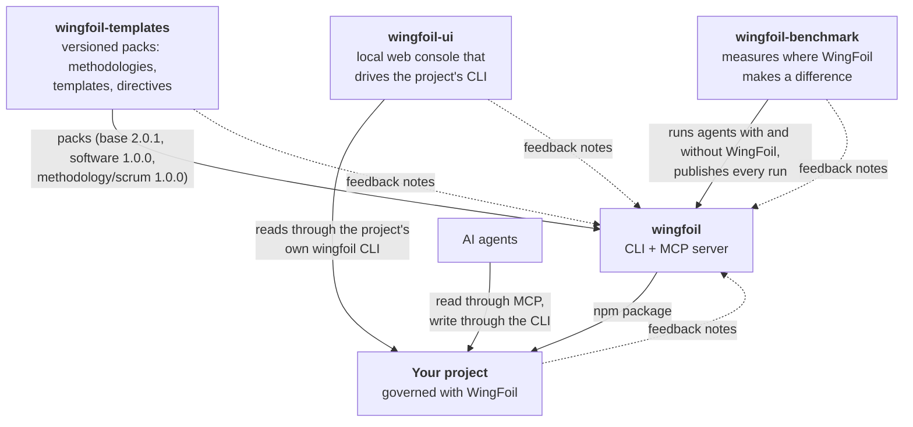

# The WingFoil ecosystem

How the public WingFoil repositories relate to each other, and to a project that uses WingFoil.
[Back to the organization](https://github.com/wingfoil).

| Flow | What travels | Where to read more |
|---|---|---|
| templates → wingfoil | Packs that `wingfoil` composes into a project's `.wingfoil/` configuration. Latest: `base` 2.0.1, the core of every governed project, `software` 1.0.0, the foundation layer for software projects, and methodology/scrum 1.0.0, a Scrum methodology pack built on both; for WingFoil 0.3.0 to 0.3.1, adopted by hand per each pack's README at its tag | [catalog](https://github.com/wingfoil/wingfoil-templates/blob/main/CATALOG.md) · [pack format, spec-001](https://github.com/wingfoil/wingfoil-templates/blob/main/docs/memory/tech-spec/spec-001-the-pack-format-manifest-fragments-composition-catalog-compatibility-and-digest.md) |
| wingfoil → your project | The `wingfoil` CLI and MCP server, from npm. Latest: v0.3.1 | [documentation site](https://wingfoil.github.io/wingfoil/) · [user guide](https://github.com/wingfoil/wingfoil/blob/main/docs/user-guide.md) |
| agents ↔ your project | Agents read DNA, Memory and workflows through MCP and change them through the CLI | [guide for agents](https://github.com/wingfoil/wingfoil/blob/main/docs/agents.md) |
| wingfoil-ui → your project | A console on your machine that opens any WingFoil project and shows its Memory, DNA, directives and team, through that project's own `wingfoil` CLI. Latest: v0.2.0, on npm (`npx wingfoil-ui`); works with WingFoil 0.2.x | [README](https://github.com/wingfoil/wingfoil-ui#readme) · [v0.2.0](https://github.com/wingfoil/wingfoil-ui/releases/tag/v0.2.0) |
| benchmark → wingfoil | Results of runs with and without WingFoil, and of Spec Kit and OpenSpec arms, by rules fixed before any run. A benchmark built and run by WingFoil's maintainer (validity threat T1); v0.2 results are preliminary | [v0.2 results](https://wingfoil.github.io/wingfoil-benchmark/81ebb2691f9c/1/) · [release notes](https://github.com/wingfoil/wingfoil-benchmark/blob/main/docs/releases/v0.2.md) |
| every project → wingfoil | Notes on WingFoil's defects, gaps and missing features, read at WingFoil's retrospectives | [feedback loop](feedback-loop.md) |

Every repository above is itself governed with WingFoil: its decisions, specs, bugs, plans and
releases are Memory elements under `docs/`, readable as live examples.
