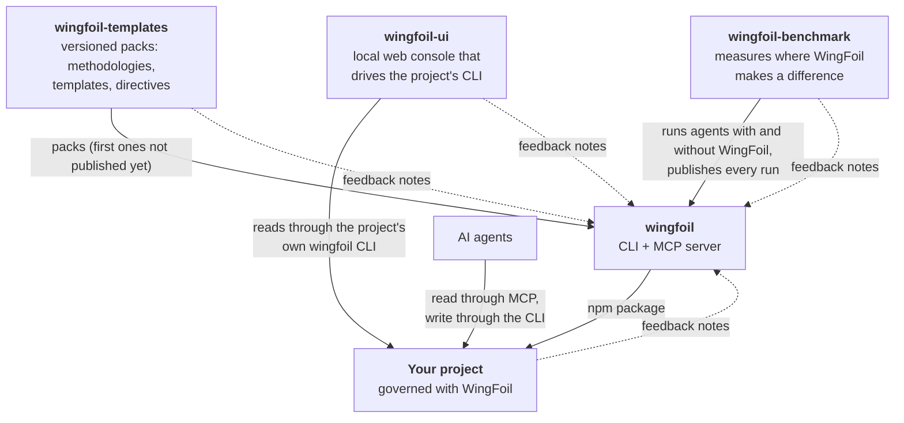

# The WingFoil ecosystem

How the public WingFoil repositories relate to each other, and to a project that uses WingFoil.
[Back to the organization](https://github.com/wingfoil).

| Flow | What travels | Where to read more |
|---|---|---|
| templates → wingfoil | Packs that `wingfoil` composes into a project's `.wingfoil/` configuration. None is published yet | [pack format, spec-001](https://github.com/wingfoil/wingfoil-templates/blob/main/docs/memory/tech-spec/spec-001-the-pack-format-manifest-fragments-composition-catalog-compatibility-and-digest.md) |
| wingfoil → your project | The `wingfoil` CLI and MCP server, from npm | [user guide](https://github.com/wingfoil/wingfoil/blob/main/docs/user-guide.md) |
| agents ↔ your project | Agents read DNA, Memory and workflows through MCP and change them through the CLI | [guide for agents](https://github.com/wingfoil/wingfoil/blob/main/docs/agents.md) |
| wingfoil-ui → your project | A console on your machine that opens any WingFoil project and shows its Memory, DNA, directives and team, through that project's own `wingfoil` CLI. Latest: v0.1.0, a read-only console | [README](https://github.com/wingfoil/wingfoil-ui#readme) · [v0.1.0](https://github.com/wingfoil/wingfoil-ui/tree/v0.1.0) |
| benchmark → wingfoil | Results of runs with and without WingFoil, by rules fixed before any run. The benchmark is built by WingFoil's maintainer | [v0.1 results](https://wingfoil.github.io/wingfoil-benchmark/c82a5e74885b/2/) |
| every project → wingfoil | Notes on WingFoil's defects, gaps and missing features, read at WingFoil's retrospectives | [feedback loop](feedback-loop.md) |

Every repository above is itself governed with WingFoil: its decisions, specs, bugs, plans and
releases are Memory elements under `docs/`, readable as live examples.
