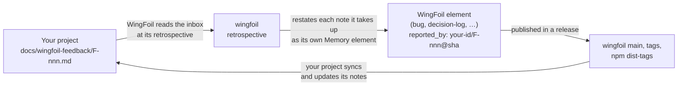

# Use WingFoil, and feed back into it

Projects that use WingFoil meet its defects, gaps and missing features while they work. This page
describes how such a project writes them down so that WingFoil can read them, answer them, and
tell the project which release answered what. It is how WingFoil's own sibling projects feed back
into WingFoil today, and any project can adopt it.
[Back to the organization](https://github.com/wingfoil).

> **Status: early.** The loop runs by hand, at WingFoil's release retrospectives; no CLI command
> automates it yet. The reference is the *Consumer feedback* section of WingFoil's
> [COLLABORATION.md](https://github.com/wingfoil/wingfoil/blob/main/COLLABORATION.md#consumer-feedback--notes-from-projects-that-use-wingfoil)
> (since v0.3.1): inbox, note format, sync points and sync procedure. This page summarises it; where
> they differ, COLLABORATION.md wins.



## 1. Keep an inbox in your repository

Create `docs/wingfoil-feedback/`, committed on your `main` (notes not on `main` are not read), with:

- a `README.md`: it must exist, because WingFoil's registration reads it; its content is yours. The
  WingFoil projects keep there the rules of the inbox, a ledger table of the notes (note, title,
  kind, status, answered by), the **source key** WingFoil assigned to the repository, and the date
  of the last sync;
- **one file per note**, `F-<nnn>-<slug>.md` (three digits or more, unique in the inbox), never
  deleted and never renumbered: one identifier, one status, one history.

A note's frontmatter has exactly these six fields:

```yaml
---
id: F-007
title: "No command updates the configuration after init"
kind: gap            # defect | gap | request
status: open         # open | needs-info | captured | resolved | declined | duplicate
wingfoil_version: 0.2.2
answered_by: []      # the WingFoil element ids, filled at sync
---
```

The body says what was **observed** and what was **expected**, reproducible with WingFoil alone:
the command, its output, the WingFoil version and the commit.

Your project writes `open`, and `duplicate` for a note that repeats another note of the same inbox.
Every other status, and `answered_by`, is set only when you sync, from what WingFoil has published,
never by judgement: `needs-info` (WingFoil asked for what a reproduction needs; you answer in the
note), `captured` (WingFoil named an element that answers it), `resolved` (every element in
`answered_by` has shipped in a release you read, or the build already behaves as the note asks),
`declined`.

## 2. Give your agents a directive

Add a directive (e.g. `.wingfoil/directives/custom/wingfoil-cli.md`, bound globally) so every
human or agent role follows the same rules:

1. Run the WingFoil version your project pins, never another one.
2. Every governance change goes through a CLI command when one exists.
3. A wrong, missing or surprising behaviour gets an entry in the directive; if it is a WingFoil
   defect or gap, also a note in `docs/wingfoil-feedback/`, with evidence.
4. Never work around silently: record the workaround in the entry and in the element being worked on.
5. When you move to a newer WingFoil version, re-check every entry and remove the fixed ones; a note
   whose answer has shipped stays `resolved`.
6. `answered_by` and the statuses other than `open` are set only by the sync.
7. Sync at every release planning and every time you move to a newer WingFoil version, and record
   the sync in the inbox README.

## 3. How WingFoil reads and answers

- **Pull, never push.** WingFoil reads your inbox; it never commits into your repository. Your
  project reads WingFoil's answer.
- **Provenance, not content.** When WingFoil takes a note up, it restates it in its own words as a
  self-contained element (a bug, a decision-log, …), with the facts reproduced in its repository; a
  defect is reproduced before it becomes an element. The element cites your note only as
  `<source key>/F-<nnn>@<sha>`.
- **When.** WingFoil reads every registered inbox at each minor release's retrospective; a patch
  release has none. A note answered earlier by a patch appears only in that patch's release
  document.
- **Where the answer is.** In WingFoil's `origin/main` (the retrospectives and the elements), its
  release tags (`vX.Y.Z` on `main` for a minor, a patch's tag on its `release/X.Y` branch) and its
  npm dist-tags (`latest`, and `latest-X.Y` for a patch of an older line): that is what your sync
  reads.
- **When you sync.** At your own release planning, before you fix its scope, and at every pin bump.
  The steps (which records to read, how each WingFoil decision maps to a note's status) are in
  COLLABORATION.md's *The sync procedure*.

## 4. Get your inbox read

Your repository must be public, and WingFoil must register it as a feedback source (an `active`
service whose feedback inbox names your folder); the service's id is your source key. A maintainer
registers it by hand, after your inbox is committed: ask through the **Proposal** issue form
of [WingFoil's issues](https://github.com/wingfoil/wingfoil/issues), naming your repository and
your inbox. Until it is registered, your feedback goes through the issue forms like anyone else's.

For a single defect or idea you do not need an inbox: open an
[issue](https://github.com/wingfoil/wingfoil/issues) — see
[COLLABORATION.md](https://github.com/wingfoil/wingfoil/blob/main/COLLABORATION.md).
