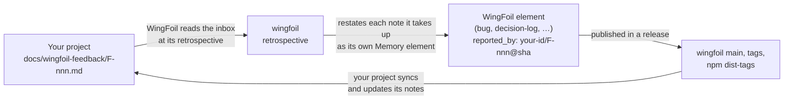

# Use WingFoil, and feed back into it

Projects that use WingFoil meet its defects, gaps and missing features while they work. This page
describes how such a project writes them down so that WingFoil can read them, answer them, and
tell the project which release answered what. It is how WingFoil's own sibling projects feed back
into WingFoil today, and any project can adopt it.
[Back to the organization](https://github.com/wingfoil).

> **Status: early.** The loop runs by hand, at WingFoil's release retrospectives; no CLI command
> automates it yet. The format below is in use by the WingFoil projects; when
> [COLLABORATION.md](https://github.com/wingfoil/wingfoil/blob/main/COLLABORATION.md) documents it,
> that file is the reference and this page will point to it.



## 1. Keep an inbox in your repository

Create `docs/wingfoil-feedback/`, committed on your default branch, with:

- a `README.md` with the rules of the inbox, a ledger table of the notes (note, title, kind,
  status, answered by), the **source key** WingFoil assigned to your repository, and the date of
  the last sync;
- **one file per note**, `F-<nnn>-<slug>.md`, never deleted and never renumbered.

A note's frontmatter has exactly these six fields:

```yaml
---
id: F-007
title: "No command updates the configuration after init"
kind: gap            # defect | gap | request
status: open         # open | needs-info | captured | resolved | declined | duplicate
wingfoil_version: 0.2.2
answered_by: []      # the WingFoil element ids, filled at sync
---
```

The body says what was **observed** and what was **expected**, reproducible with WingFoil alone:
the command, its output, the WingFoil version and the commit.

Your project writes `open`. Every other status, and `answered_by`, is set only when you sync, from
what WingFoil has published, never by judgement.

## 2. Give your agents a directive

Add a directive (e.g. `.wingfoil/directives/custom/wingfoil-cli.md`, bound globally) so every
human or agent role follows the same rules:

1. Run the WingFoil version your project pins, never another one.
2. Every governance change goes through a CLI command when one exists.
3. A wrong, missing or surprising behaviour gets an entry in the directive; if it is a WingFoil
   defect or gap, also a note in `docs/wingfoil-feedback/`, with evidence.
4. Never work around silently: record the workaround in the entry and in the element being worked on.
5. When you move to a newer WingFoil version, re-check every entry and remove the fixed ones; a note
   whose answer has shipped stays `resolved`.
6. `answered_by` and the statuses other than `open` are set only by the sync.
7. Sync at every release planning and every time you move to a newer WingFoil version, and record
   the sync in the inbox README.

## 3. How WingFoil reads and answers

- **Pull, never push.** WingFoil reads your inbox; it never commits into your repository. Your
  project reads WingFoil's answer.
- **Provenance, not content.** When WingFoil takes a note up, it restates it in its own words as a
  self-contained element (a bug, a decision-log, …), with the facts reproduced in its repository; a
  defect is reproduced before it becomes an element. The element cites your note only as
  `<source key>/F-<nnn>@<sha>`.
- **When.** Notes are read at WingFoil's release retrospective. Urgent fixes and documentation may
  be taken into a patch release earlier; anything that changes a release's scope waits for the
  retrospective.
- **Where the answer is.** In WingFoil's `main` branch, its release tags and its npm dist-tags:
  that is what your sync reads.

## 4. Get your inbox read

Your repository must be public, and WingFoil must register it as a feedback source; that gives you
your source key. Registration is done by a maintainer, by hand, for now: ask in
[Discussions](https://github.com/wingfoil/wingfoil/discussions) with the URL of your inbox.

For a single defect or idea you do not need an inbox: open an
[issue](https://github.com/wingfoil/wingfoil/issues) — see
[COLLABORATION.md](https://github.com/wingfoil/wingfoil/blob/main/COLLABORATION.md).
