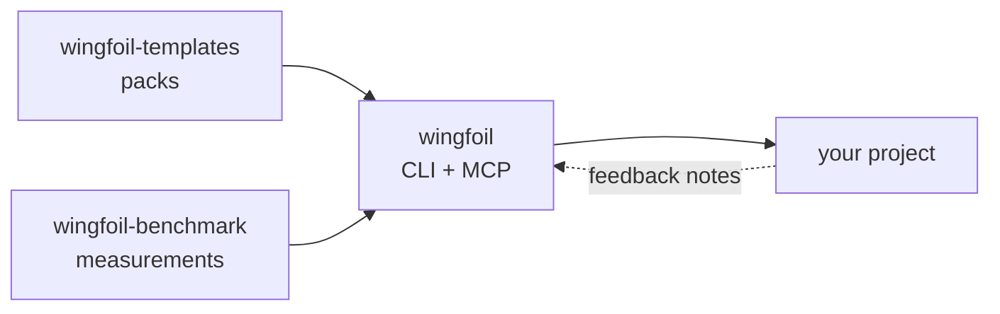

<p align="center"></p>

<h1 align="center">WingFoil</h1>

<p align="center"><b>The repo-native record of intent and approvals for AI-assisted engineering —
validated, attributable, readable by any agent.</b></p>

WingFoil keeps your project's intent in git — tasks, specs, ADRs, decision logs, bugs — as typed
documents with their own state machines. Every approval records who decided and why, in the commit.
It works alongside the spec-driven tools and coding agents you already use, through a CLI and an
MCP server.

```bash
npm install -g wingfoil
wingfoil init --template Scrum
```

## Ecosystem



| Repository | What it is | Latest |
|------------|------------|--------|
| [**wingfoil**](https://github.com/wingfoil/wingfoil) | The core: CLI + MCP server — Memory, DNA, Directives, Workflows | [npm 0.2.2](https://www.npmjs.com/package/wingfoil) |
| [**wingfoil-templates**](https://github.com/wingfoil/wingfoil-templates) | Versioned packs of templates, methodologies and directives that WingFoil consumes | no pack published yet |
| [**wingfoil-benchmark**](https://github.com/wingfoil/wingfoil-benchmark) | Measures where WingFoil makes a difference, against plain agents and other tools | [v0.1 results](https://wingfoil.github.io/wingfoil-benchmark/c82a5e74885b/2/) |

More: [how the repositories relate](https://github.com/wingfoil/.github/blob/main/docs/ecosystem.md).

## Resources

- 📚 [For users](https://github.com/wingfoil/.github/blob/main/docs/resources.md) — packages, guides,
  releases and benchmark results
- 🤖 [For AI agents](https://github.com/wingfoil/.github/blob/main/docs/for-agents.md) — MCP server
  and the files written for agents
- 🔁 [Feed back into WingFoil](https://github.com/wingfoil/.github/blob/main/docs/feedback-loop.md) —
  how a project using WingFoil reports defects and requests, and learns which release answered them

## Get involved

- 💬 [Discussions](https://github.com/wingfoil/wingfoil/discussions) — questions and ideas
- 🐞 [Issues](https://github.com/wingfoil/wingfoil/issues) — bugs and proposals
- 🤝 [How to contribute](https://github.com/wingfoil/wingfoil/blob/main/COLLABORATION.md) — through Memory, not (only) code

## Transparency

- Every repository here is governed with WingFoil itself: its Memory is public under `docs/`.
- The benchmark is built by WingFoil's maintainer: its rules are fixed before any run, losses are
  published like wins, and every run's record, cost and transcript are public.
- Security reports: see [SECURITY.md](https://github.com/wingfoil/.github/blob/main/SECURITY.md).
- All repositories are MIT licensed.
